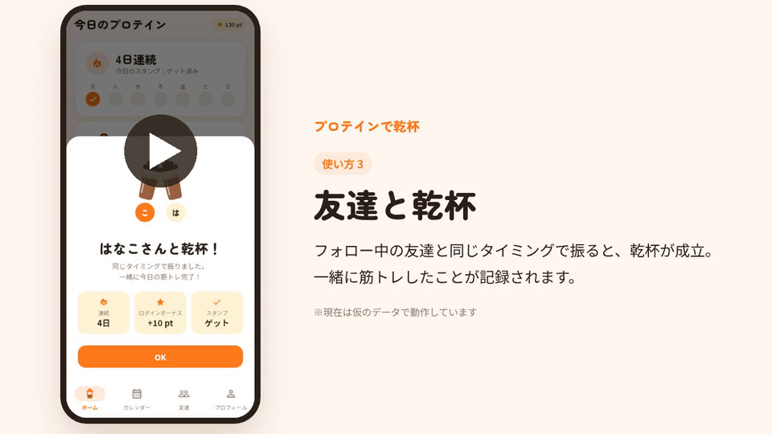
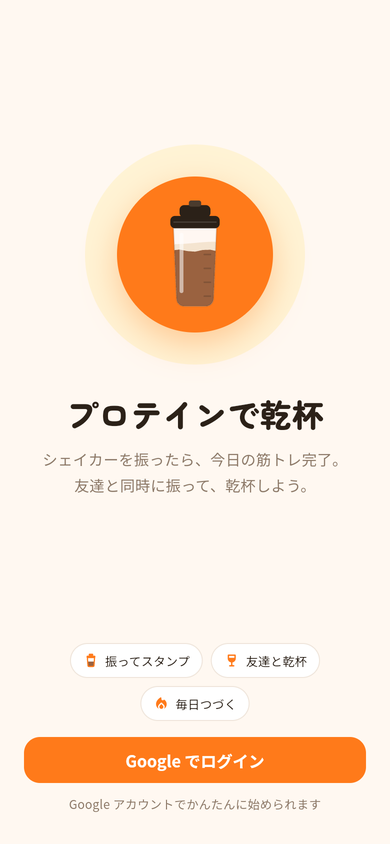
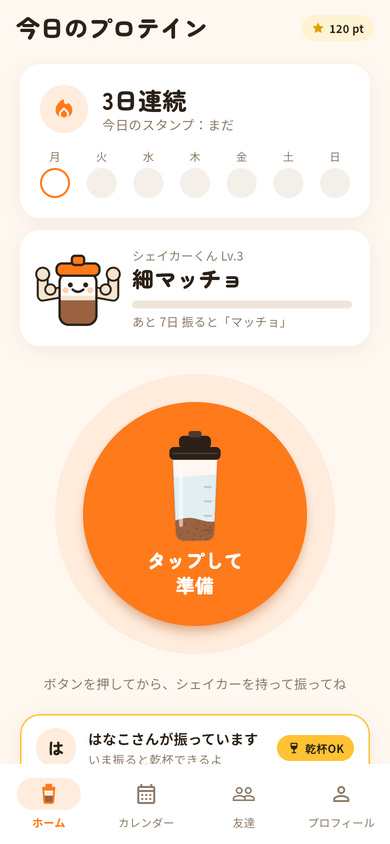
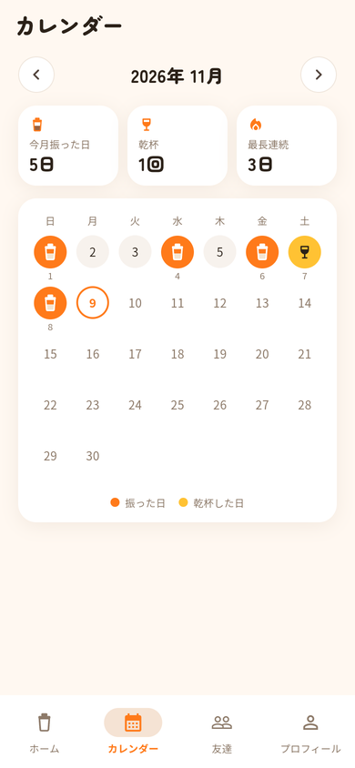
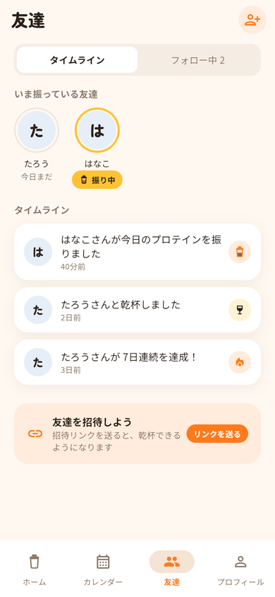
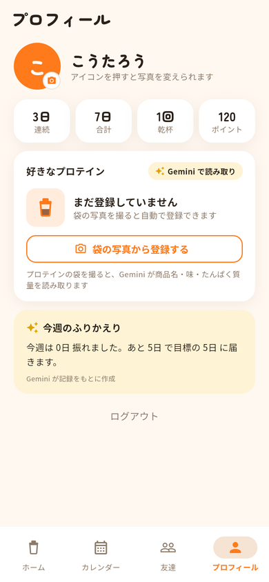
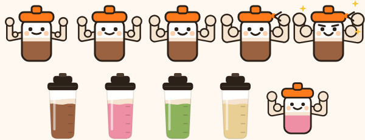
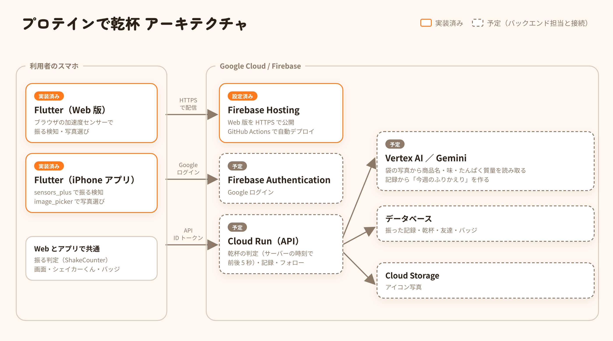

# プロテインで乾杯 🥤

[](https://github.com/kotakota914/protein-kanpai/actions/workflows/deploy.yml)

**シェイカーを振ったら、今日の筋トレ完了。友達と同時に振れば「乾杯」になる。**

運動を一人で続けられない人のための、スマホのブラウザで使える Web アプリです。
DevFest GDGoC Japan Hackathon 2026 に向けて、Flutter Web で開発しています。

### 紹介動画（約 2 分・音声あり）

[](docs/video/intro.mp4)

使い方・機能・工夫した点を約 2 分で紹介しています（画像をクリックすると再生ページが開きます）。

- ナレーションは AI の音声合成（[Kokoro](https://huggingface.co/hexgrad/Kokoro-82M)、Apache License 2.0）で作成
- 動画の中のアプリは**仮のデータ**で動いています。振る場面は、ブラウザで揺れのデータを送って再現しています（実機で振った映像ではありません）

<p>
  
  
  
  
  
</p>

---

## 目次

- [紹介動画](#紹介動画約-2-分音声あり)
- [なぜ作ったか](#なぜ作ったか)
- [できること](#できること)
- [しくみ](#しくみ)
- [技術構成と選んだ理由](#技術構成と選んだ理由)
- [動かし方](#動かし方)
- [iPhone アプリとして動かす（Xcode）](#iphone-アプリとして動かすxcode)
- [公開（Firebase Hosting）](#公開firebase-hosting)
- [フォルダ構成](#フォルダ構成)
- [バックエンドとの接続](#バックエンドとの接続)
- [ハッカソンへの提出](#ハッカソンへの提出)
- [開発のルール](#開発のルール)
- [使用している素材とライセンス](#使用している素材とライセンス)

---

## なぜ作ったか

運動したい気持ちはあるのに、続かない。スポーツ庁の調査（令和6年度、18〜79歳・40,000人）では、週 1 日以上運動している人は **52.5%**、運動したいと思っている人は **66.6%** で、**14.1 ポイントの差**があります。できなかった理由の 1 位は「**面倒くさいから**」（38.1%）で、「**仲間がいないから**」（11.4%）も挙がっています。
（出典：[スポーツ庁「令和6年度 スポーツの実施状況等に関する世論調査」](https://www.mext.go.jp/sports/b_menu/houdou/jsa_00202.html)）

そこで、**プロテインを飲む前にシェイカーを振る**という毎日の行動を、そのまま記録にしました。入力はゼロ。友達と同じタイミングで振れば乾杯になり、一緒にがんばっていることが伝わります。

| 課題 | このアプリの答え |
|---|---|
| 面倒くさい | シェイカーを**振るだけ**で記録 |
| 一人だと続かない | 友達と**同時に振ると乾杯**。「いま〇〇さんが振っています」で誘い合える |
| 続ける理由がない | 連続日数・スタンプ・キャラクターの成長で、**今日の 1 回**に意味を持たせる |
| 振り返らない | Gemini が記録から「今週のふりかえり」を作る（予定） |

## できること

| 画面 | 内容 |
|---|---|
| ログイン | Google でログイン |
| ホーム | 連続日数と今週のスタンプ、シェイカーくん（キャラクター）、シェイカーを振って記録、いま振っている友達 |
| 振った結果 | スタンプ・乾杯・連続日数・ログインボーナス・シェイカーくんの成長 |
| カレンダー | 振った日と乾杯した日のスタンプ、月ごとの集計 |
| 友達 | いま振っている友達、タイムライン、フォロー、招待 |
| プロフィール | 写真からアイコンを選ぶ、記録、好きなプロテイン（袋の写真から登録）、今週のふりかえり |

### シェイカーくん（キャラクター）



- **振った日数（＝筋トレした日数）**で 5 段階に育ちます：ひよっこ → ちょいマッチョ（3日）→ 細マッチョ（7日）→ マッチョ（14日）→ ムキムキ（30日）
- プロテインを飲んだ量ではなく日数で育てるので、1 日に何回振っても 1 日分。飲みすぎを促しません。
- 好きなプロテインの**味でシェイクの色が変わります**（ココア・ストロベリー・抹茶・バニラなど）。

### 実装の状況

いまは**すべて仮のデータ（モック）で動きます**。ページを読み込み直すと最初の状態に戻ります。

| 機能 | 状況 |
|---|---|
| 画面（7 画面）・画面の移動 | ✅ 実装済み |
| 振る検知（加速度センサー、iPhone の許可対応） | ✅ 実装済み（実機での調整が必要） |
| 写真からアイコンを選ぶ（端末で 320px に縮小） | ✅ 実装済み（保存はバックエンド待ち） |
| シェイカーくんの成長・味ごとの色 | ✅ 実装済み |
| ログイン・記録・乾杯の判定・フォロー | ⏳ バックエンドと接続予定 |
| 袋の写真の読み取り・今週のふりかえり（Gemini） | ⏳ バックエンドと接続予定 |

## しくみ

### 振る検知

```
ボタンを押す ──▶ センサーの使用許可（iPhone のみ）──▶ 加速度を監視
                                                         │
          重力の 2.5 倍を超える揺れを 2 秒以内に 8 回 ◀──┘
                                │
                                ▼
                     「振った」と判定して記録
```

- Web 版はブラウザの加速度センサー（`devicemotion`）を直接使っています。定番の `sensors_plus` は iPhone の Safari で値が届かない報告があるため、Web では使っていません。iPhone アプリ版は `sensors_plus` を使います。
- 判定の計算は Web とアプリで共通（`lib/shake/shake_counter.dart`）。数え時間は**最初の強い揺れから** 2 秒です（センサーは振っていない間も値を送ってくるため）。
- iPhone ではボタンを押したときにセンサーの使用許可を求めます。**HTTPS で公開したページでないと動きません。**
- 強さ・回数は `lib/shake/shake_counter.dart` で調整します。
- 振るボタンの中のシェイカーは、振るほど粉が混ざってプロテインの色になります。

### 乾杯

フォロー中の友達が**前後 5 秒以内に振ったら乾杯成立**。判定は端末ではなくサーバーの時刻で行います（予定。詳細は [`docs/api-contract.md`](docs/api-contract.md)）。

## 技術構成と選んだ理由

| 技術 | 用途 | 選んだ理由 |
|---|---|---|
| **Flutter（Web）** | 画面 | チームに経験者がいる。シェイカーやキャラクターのアニメーションを自由に描ける。Google 技術でそろえられる |
| **Firebase Hosting** | 公開 | 加速度センサーは HTTPS が必須。静的ファイルを CDN と HTTPS 付きで配信できる |
| **Firebase Authentication** | Google ログイン（予定） | パスワードを自前で持たずに済む |
| **Cloud Run** | API（予定） | 乾杯の判定はサーバーの時刻で行う必要がある。使わないときは 0 台まで縮む |
| **Vertex AI の Gemini** | 袋の写真の読み取り・ふりかえり（予定） | 写真から商品名・味・たんぱく質量を構造化して取り出せる |
| **Cloud Storage** | アイコン写真（予定） | 友達の画面にも出す画像を安全に配れる |



## 動かし方

[Flutter](https://docs.flutter.dev/get-started/install)（stable）が必要です。

```bash
flutter pub get
```

```bash
flutter run -d chrome --dart-define=DEV_TOOLS=true
```

`DEV_TOOLS=true` を付けると、PC でも確認できるように「（開発用）振ったことにする」ボタンが出ます。**提出・デモ用のビルドには付けないでください**（デモ動画の偽装とみなされないように）。

テストと静的チェック:

```bash
flutter test
```

```bash
flutter analyze
```

公開用のビルド（日本語フォントと描画エンジンを同梱し、外部に通信しない）:

```bash
flutter build web --release --no-web-resources-cdn
```

## iPhone アプリとして動かす（Xcode）

実機で振る検知を試したいときは、iPhone アプリとして動かせます（無料の Apple ID でOK）。手順は [`docs/ios.md`](docs/ios.md)。

```bash
open ios/Runner.xcworkspace
```

```bash
flutter run --release -d "あなたのiPhoneの名前"
```

## 公開（Firebase Hosting）

`main` に push すると、GitHub Actions（`.github/workflows/deploy.yml`）が静的チェック・テスト・ビルドを行い、Firebase の設定がそろっていれば Firebase Hosting に公開します。

**最初に一度だけ設定すること：**

1. [Firebase コンソール](https://console.firebase.google.com)でプロジェクトを作る
2. プロジェクトの設定 → サービスアカウント → 「新しい秘密鍵を生成」で JSON をダウンロード
3. GitHub のリポジトリ → Settings → Secrets and variables → Actions
   - **Secrets**：`FIREBASE_SERVICE_ACCOUNT` に JSON の中身をそのまま
   - **Variables**：`FIREBASE_PROJECT_ID` にプロジェクト ID
   - （任意）**Variables**：`DEV_TOOLS` に `true` で開発用ボタン付きで公開

> ⚠️ 秘密鍵の JSON は**絶対にリポジトリに入れない**でください（公開リポジトリです）。

## フォルダ構成

```
lib/
├── main.dart                 アプリの入口
├── app/                      テーマ（色・文字）と画面の移動
├── data/                     データの形・成長段階・データの窓口（AppRepository）
├── features/                 画面ごとのコード
│   ├── login/  home/  calendar/  friends/  profile/
├── shake/                    振る検知（判定の計算は共通、センサーは Web とアプリで別）
├── photo/                    写真の選択と縮小（Web とアプリで別）
└── widgets/                  共通の部品（カード・シェイカー・シェイカーくん）
ios/                          iPhone アプリ用（Xcode で開く）
test/                         自動テスト
docs/                         API の約束・提出用の下書き・画像・紹介動画
scripts/                      提出用リポジトリへのコピー、紹介動画の作り方（scripts/video）
```

## バックエンドとの接続

画面が使うデータは [`lib/data/app_repository.dart`](lib/data/app_repository.dart) にまとめてあります。いまは仮のデータで、バックエンドができたらこのクラスの中身だけを差し替えます。差し替える箇所には `TODO(backend)` と書いてあります。

API の形（エンドポイント・返す JSON・エラー・安全性の確認項目）は [`docs/api-contract.md`](docs/api-contract.md) にまとめています。

## ハッカソンへの提出

| ファイル | 内容 |
|---|---|
| [`docs/product.md`](docs/product.md) | プロダクト説明の下書き（`【要記入】` を埋める） |
| [`docs/copyright-sheet.md`](docs/copyright-sheet.md) | 著作物利用シートの下書き |
| [`docs/demo-script.md`](docs/demo-script.md) | デモ動画の台本（セリフ付き） |
| [`docs/submission.md`](docs/submission.md) | **提出の手順書**（締切前にこれを上から順に） |

提出用リポジトリ（運営の `df-2026-t071`）へは、履歴ごとではなく最新のファイルだけをコピーします（過去のコミットに秘密情報があっても公開されないように）。

```bash
git clone https://github.com/Devfest-Hackathon-2026/df-2026-t071.git ../df-2026-t071
```

```bash
scripts/export-to-submission.sh ../df-2026-t071
```

内容を確認してから、`../df-2026-t071` で `git push` します。締切：**2026-11-10（火）17:00**。

## 開発のルール

- `main` に push する前に `flutter analyze` と `flutter test` を通す（GitHub Actions でも確認されます）
- API キー・サービスアカウントの鍵・`.env` はコミットしない
- 画面の言葉は短く、具体的に。エラーは「何が起きたか・どうすればいいか」を書く
- デモ動画は実機で本当に振って撮る（開発用ボタンは使わない）

## 使用している素材とライセンス

| 素材 | ライセンス |
|---|---|
| Noto Sans JP（`assets/fonts/NotoSansJP-*.ttf`） | SIL Open Font License 1.1（[`OFL-NotoSansJP.txt`](assets/fonts/OFL-NotoSansJP.txt)） |
| Zen Maru Gothic（`assets/fonts/ZenMaruGothic-Black.ttf`） | SIL Open Font License 1.1（[`OFL-ZenMaruGothic.txt`](assets/fonts/OFL-ZenMaruGothic.txt)） |
| Material Icons（Flutter 同梱） | Apache License 2.0 |
| Flutter・go_router・package:web・sensors_plus・image_picker | BSD 3-Clause |
| cupertino_icons | MIT |
| シェイカー・シェイカーくんのイラスト | チームがコードで描画（`lib/widgets/`） |
| 紹介動画のナレーション | [Kokoro-82M](https://huggingface.co/hexgrad/Kokoro-82M)（音声 `jf_alpha`）で生成。Apache License 2.0 |

詳しくは [`docs/copyright-sheet.md`](docs/copyright-sheet.md)。
