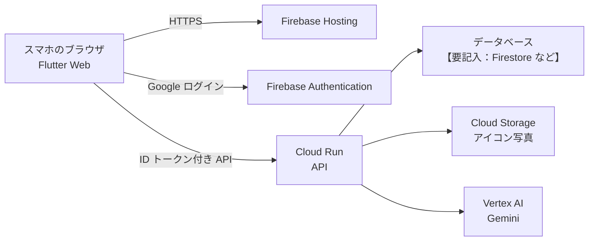

# プロダクト説明（下書き）

運営の「プロダクト説明ドキュメント」テンプレートに転記するための下書き。`【要記入】` はチームで埋める。
**実装済み**と**予定**を正直に分けて書く（デモ動画と食い違わないようにする）。

## 1. 概要

**プロテインで乾杯** — シェイカーを振ったら、今日の筋トレ完了。友達と同時に振れば「乾杯」になる。運動を一人で続けられない人のための、スマホのブラウザで使える Web アプリ。

- カテゴリ：**医療・福祉**（運動習慣づくり・健康寿命）【要確認：チームで最終決定】
- 公開 URL：【要記入：Firebase Hosting の URL】
- リポジトリ：https://github.com/kotakota914/protein-kanpai

## 2. 解決する課題（誰の・どんな課題か）

- 誰の：筋トレや運動を始めたが、一人だと続かない大学生・若い社会人
- どんな課題：「健康寿命」のような目標は遠すぎて実感がなく、記録アプリは入力が面倒で続かない
- 根拠：【要記入：厚生労働省「国民健康・栄養調査」の運動習慣のある人の割合など、一次資料の数字と出典】

## 3. 解決のしかた

| 課題 | このアプリの仕組み |
|---|---|
| 記録が面倒 | プロテインを飲む前に**シェイカーを振るだけ**で記録（入力ゼロ） |
| 一人だと続かない | フォロー中の友達と**同じタイミングで振ると乾杯**。「いま〇〇さんが振っています」で誘い合える |
| 目標が遠い | 連続日数・週のスタンプ・ログインボーナスで、**今日の 1 回**に意味を持たせる |
| 振り返らない | Gemini が記録から「今週のふりかえり」を作る（予定） |

## 4. 機能と実装状況

| 機能 | 状況 |
|---|---|
| 振る検知（スマホの加速度センサー、8 回で判定、iPhone の許可対応） | 実装済み（実機での調整は【要記入】） |
| 振った結果（スタンプ・乾杯・連続日数・ボーナス）の表示 | 画面は実装済み／判定はバックエンド予定 |
| カレンダー（振った日・乾杯した日） | 画面は実装済み／データはバックエンド予定 |
| 友達（いま振っている人・タイムライン・フォロー） | 画面は実装済み／データはバックエンド予定 |
| 写真からアイコンを選ぶ | 実装済み（保存はバックエンド予定） |
| プロテインの袋の写真から登録（Gemini） | 画面は実装済み／Gemini 連携は予定 |
| 今週のふりかえり（Gemini） | 画面は実装済み／Gemini 連携は予定 |

## 5. Google 技術と選んだ理由

| 技術 | 用途 | 状況 | 選んだ理由（比較した案） |
|---|---|---|---|
| Flutter（Web） | 画面 | 実装済み | チームに経験者がいる。シェイカーのアニメーションなど独自の描画を自由に作れる（比較：React。Google 技術で統一でき、描画の自由度が高い Flutter を選んだ） |
| Firebase Hosting | 公開（実行基盤） | 設定済み・公開は【要記入】 | 加速度センサーは HTTPS 必須。Flutter Web を静的配信でき、CDN と HTTPS が標準で付く（比較：Cloud Run で配信。静的ファイルだけなので Hosting で十分） |
| Firebase Authentication | Google ログイン | 予定 | パスワード管理を自前で持たずに済む |
| Cloud Run | API（乾杯の判定・記録） | 予定（バックエンド担当） | 乾杯の判定はサーバーの時刻で行う必要がある。リクエストがないときは 0 台まで縮み、クレジットを節約できる |
| Vertex AI の Gemini | 袋の写真の読み取り、今週のふりかえり | 予定（バックエンド担当） | 写真から商品名・たんぱく質量を構造化して取り出せる。Cloud Credit は AI Studio に使えないため Vertex AI 経由 |
| Cloud Storage | アイコン写真の保存 | 予定 | 友達の画面にも出す画像を、署名付き URL などで安全に配れる |

**Gemini がないと何が困るか**：袋の写真から商品名やたんぱく質量を手入力する必要があり、登録されなくなる。記録が数字の羅列のままで、振り返る理由が生まれない。

## 6. アーキテクチャ

提出時は公式アイコン（cloud.google.com/icons）で描き直す。API の詳細は `docs/api-contract.md`。

## 7. 安全性・拡張性・保守性

- 加速度センサーは iPhone では**ボタンを押したときに許可を求める**。許可されなければ理由と設定方法を表示する。
- アイコン写真は端末で 320px に縮め、2MB を超えるものは受け付けない（サーバー側でも確認する予定）。
- 公開ページは外部に通信しない構成（日本語フォントと描画エンジンを同梱）。
- 開発用の「振ったことにする」ボタンは、提出・デモ用のビルドには出ない（`DEV_TOOLS` で切り替え）。
- 画面とデータの取得を分けている（`AppRepository`）。バックエンドの差し替えは 1 か所で済む。
- 自動テスト 10 件、静的チェック、ビルドを GitHub Actions で毎回実行。

## 8. AI をどの場面でどう使ったか（必須記入）

- **プロダクトの中**：Gemini（予定）— 袋の写真の読み取り、今週のふりかえり。
- **開発中**：AI コーディング支援ツール（Claude Code）を、画面の実装・テスト・デザイン案の作成に使った。【要記入：チームが AI の提案をどう判断したか】
  - 例：最初のデザインが「AI が作った感じ」がすると感じ、ジム風の案も作らせて比べた。比べた結果、チームで元のデザインを選んだ。
  - 例：シェイク検知は、定番パッケージ（sensors_plus）に iPhone で動かない報告があるとわかり、ブラウザの機能を直接使う方法を選んだ。

## 9. 開発を通して得たこと・成長（必須記入）

【要記入：チーム各自の言葉で】
