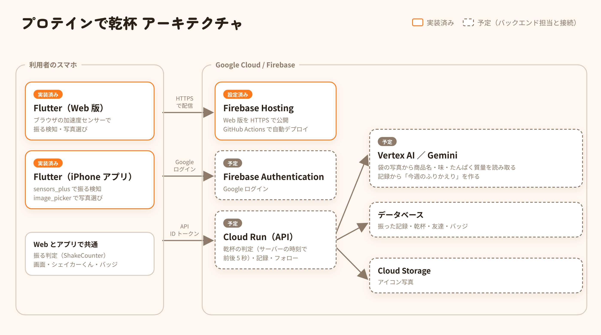

# プロダクト説明（提出用の下書き）

運営の「プロダクト説明ドキュメント」テンプレートに転記するための下書き。
`【要確認】` はチームで確かめる所、`【要記入】` はチームが自分の言葉で書く所。
**実装済み**と**予定**を分けて書いている（デモ動画・審査員の操作と食い違わないようにするため）。

## 1. 概要

**プロテインで乾杯** — シェイカーを振ったら、今日の筋トレ完了。友達と同時に振れば「乾杯」になる。
運動を一人で続けられない人のための、スマホで使えるアプリ（Web 版と iPhone アプリ版）。

| 項目 | 内容 |
|---|---|
| カテゴリ | **医療・福祉**（運動習慣づくり・健康づくり）【要確認：チームで最終決定】 |
| 公開 URL | 【要記入：Firebase Hosting の URL】 |
| リポジトリ | https://github.com/kotakota914/protein-kanpai （提出用リポジトリにも同じ内容をコピー） |
| 紹介動画 | リポジトリの `docs/video/intro.mp4`（README から再生可） |

## 2. 解決する課題（誰の・どんな課題か）

**誰の**：運動を始めたい・続けたいのに続かない、大学生や若い社会人。

**どんな課題か**：運動したい気持ちはあるのに、「面倒くさい」と「一人だと続かない」で止まってしまう。

**根拠**（スポーツ庁「令和6年度 スポーツの実施状況等に関する世論調査」、令和6年11月実施、18〜79歳、有効回収 40,000件）

- 週1日以上の運動・スポーツ実施率は **52.5%** だが、「実施したい」と思う人は **66.6%**。**14.1 ポイントの差**がある。特に 20代〜40代の女性で差が大きい。
- 週1日以上運動できなかった理由の 1 位は「**面倒くさいから**」（**38.1%**）。週1日以上運動したいと思っている人に限ると **43.2%**。
- 「**仲間がいないから**」も 11.4%（運動したい人に限ると 14.1%）。
- 勤務先に運動の取り組みがある人の実施率は 70.1% と高く、**周りの環境や仲間**が運動を後押しすることがわかる。

出典：
- 結果の公表ページ https://www.mext.go.jp/sports/b_menu/houdou/jsa_00202.html
- 結果の概要（別紙） https://www.mext.go.jp/sports/content/250313-spt_kensport01-000040806_02.pdf （「面倒くさいから」「仲間がいないから」は 22〜23 ページの Q13）

## 3. 解決のしかた

| 課題 | このアプリの仕組み |
|---|---|
| 面倒くさい | プロテインを飲む前に**シェイカーを振るだけ**で記録。入力はゼロ |
| 一人だと続かない | フォロー中の友達と**同じタイミングで振ると「乾杯」**。「いま〇〇さんが振っています」で誘い合える |
| 続ける理由がない | 連続日数・週のスタンプ・ログインボーナス・**シェイカーくん（振った日数で育つキャラクター）**・バッジ |
| 振り返らない | Gemini が記録から「今週のふりかえり」を作る（予定） |

## 4. 機能と実装状況

| 機能 | 状況 |
|---|---|
| 振る検知（加速度センサー、8回で判定。Web はブラウザ、iPhone アプリは端末のセンサー） | ✅ 実装済み。iPhone 実機で動作確認済み |
| 振った結果（スタンプ・乾杯・連続日数・ボーナス・成長・新しいバッジ） | ✅ 画面は実装済み／判定はバックエンドと接続予定 |
| 乾杯の演出（2本のシェイカーがぶつかって泡がはじける） | ✅ 実装済み |
| シェイカーくん（振った日数で 5 段階に成長） | ✅ 実装済み |
| 好きなプロテインの味でシェイカーの色が変わる | ✅ 実装済み |
| バッジ（9 種類） | ✅ 実装済み |
| カレンダー（振った日・乾杯した日） | ✅ 画面は実装済み／データはバックエンドと接続予定 |
| 友達（いま振っている人・タイムライン・フォロー） | ✅ 画面は実装済み／データはバックエンドと接続予定 |
| 写真からアイコンを選ぶ（端末で 320px に縮小） | ✅ 実装済み（保存はバックエンドと接続予定） |
| 袋の写真からプロテインを登録（Gemini） | ✅ 画面は実装済み／Gemini との接続は予定 |
| 今週のふりかえり（Gemini） | ✅ 画面は実装済み／Gemini との接続は予定 |
| ログイン（Google） | 画面は実装済み／Firebase Authentication と接続予定 |

【要確認：提出時点でバックエンドとつながった機能は「予定」→「実装済み」に書き換える】

## 5. Google 技術と選んだ理由

| 技術 | 用途 | 状況 | 選んだ理由（比較した案） |
|---|---|---|---|
| Flutter | 画面（Web と iPhone アプリ） | 実装済み | チームに経験者がいる。1 つのコードで Web と iPhone アプリの両方を作れる。シェイカーやキャラクターの描画を自由に作れる（比較：React。Web しか作れず、描画の自由度も Flutter が上） |
| Firebase Hosting | 公開（実行基盤） | 設定済み・公開は【要確認】 | スマホの加速度センサーは HTTPS 必須。Flutter Web を静的配信でき、CDN と HTTPS が標準で付く。GitHub に push すると自動で公開される（`.github/workflows/deploy.yml`） |
| Firebase Authentication | Google ログイン | 予定 | パスワードを自前で持たずに済む |
| Cloud Run | API（乾杯の判定・記録） | 予定 | 乾杯の判定は端末ではなく**サーバーの時刻**で行う必要がある。使わないときは 0 台まで縮み、クレジットを節約できる |
| Vertex AI の Gemini | 袋の写真の読み取り、今週のふりかえり | 予定 | 写真から商品名・味・たんぱく質量を構造化して取り出せる。Cloud Credit は AI Studio に使えないため Vertex AI 経由 |
| Cloud Storage | アイコン写真の保存 | 予定 | 友達の画面にも出す画像を安全に配れる |

**Gemini がないと何が困るか**：袋の写真から商品名やたんぱく質量を手で入力する必要があり、「面倒くさい」に逆戻りする。記録が数字の羅列のままで、振り返る理由が生まれない。

## 6. アーキテクチャ

API の詳細は `docs/api-contract.md`。

## 7. 安全性・拡張性・保守性

- **健康への配慮**：シェイカーくんは「飲んだ量」ではなく「振った日数（＝筋トレした日数）」で育つ。1 日に何回振っても 1 日分しか数えないので、プロテインの飲みすぎを促さない。Gemini のふりかえりでも医療的な助言はしない（予定）。
- **センサーの許可**：iPhone ではボタンを押したときにセンサーの使用許可を求め、許可されなければ理由と設定方法を表示する。iPhone アプリでは、使う理由を `Info.plist` に書いている。
- **写真**：端末で 320px に縮め、2MB を超えるものは受け付けない（サーバー側でも確認する予定）。
- **秘密情報**：API キーや鍵はリポジトリに入れない（`.gitignore`、提出用コピーのスクリプトでも確認）。
- **デモの正直さ**：開発用の「振ったことにする」ボタンは、提出・デモ用のビルドには出ない（`DEV_TOOLS` で切り替え）。
- **保守性**：画面とデータの取得を分けている（`AppRepository`）。バックエンドの差し替えは 1 か所で済む。振る判定の計算は Web とアプリで共通（`ShakeCounter`）。
- **テスト**：自動テスト 24 件（振る判定・成長・バッジ・画面の移動など）。push するたびに GitHub Actions で静的チェック・テスト・ビルドを実行。

## 8. AI をどの場面でどう使ったか（必須記入）

【要確認：チームの実感に合わせて書き直す】

- **プロダクトの中**：Gemini（予定）— 袋の写真の読み取りと、今週のふりかえり。入力の手間を減らし、記録に意味を持たせる場面に限って使う。
- **開発中**：AI コーディング支援（Claude Code）を、画面の実装・テスト・デザイン案・紹介動画づくりに使った。AI の提案をそのまま採用せず、比べて選んだ例：
  - **デザイン**：最初の案を「AI が作った感じがする」と感じ、ジム風の黒×アンバーの案も作って比べた。比べた結果、親しみやすさを優先して元のクリーム色×オレンジの案に戻した。
  - **振る検知**：定番のパッケージ（sensors_plus）が iPhone の Safari で値を受け取れない報告を見つけ、Web 版ではブラウザの機能を直接使う方法を選んだ。iPhone アプリ版では sensors_plus を使い、判定の計算は共通にした。
  - **不具合の発見**：実機で試す前のテストで、「2 秒以内に 8 回」の 2 秒をボタンを押した時から数えていたため、構えてから振ると数え直しになる不具合が見つかった。最初の揺れから数えるように直した。
  - **健康面**：「プロテインを飲むほどムキムキ」という案を、飲みすぎを促さないよう「振った日数で育つ」に変えた。

## 9. 開発を通して得たこと・成長（必須記入）

【要記入：チーム各自の言葉で。以下はメモ】

- Flutter で Web と iPhone アプリの両方を作り、Xcode・署名・実機へのインストールまで一通り経験した
- 「Google ドライブの中に Flutter を置くと動かない」「Xcode に Apple ID でサインインできない（パスワードを再設定して解決）」など、環境構築でのつまずきと解決
- AI の提案を比べて選び、選んだ理由と捨てた案を残す進め方
